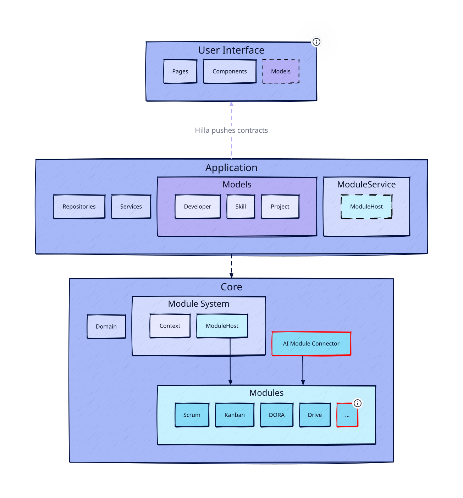

# engman

**A strategic management tool for software engineering managers (_engmans_), where management theories are pluggable modules.**

---

_Do you ever wonder what actually keeps your best developer here? **Deci & Ryan**'s self-determination theory [1] says autonomy, competence and relatedness carry the weight, and **Daniel Pink** [2] built a whole book on it. But money is worth something too. And I need to decide on raises next month..._

_Have you hesitated before giving someone a harder goal? **Locke & Latham** [3] say specific and difficult goals beat easy ones, but only when the ability and the commitment are already there. **Csikszentmihalyi** [4] would ask whether the challenge matches the skill. But which one is right for your organization?_

_**True Colors** [5] says Alex is a 🟢 Green and Sam is an 🟠 Orange, and that is why they are fighting all the time. Or is it an expected phenomenon because their team is still **Storming** and that friction is healthy [6], right?_

_Is anyone still practicing **Agile** [7] or **Scrum** [8], or are we just taking attendance on the radio? Do we still value individuals and interactions? Do I even have time for a weekly 1:1 with everyone on my team [14]? And what does that lean startup thing even mean [10]?_

_And who the hell is going to take responsibility for all the mass generated by agents?_

---

There are dozens of engineering-management theories that speak to exactly these questions, and every tool you use has already picked one for you. Jira means Scrum. Your HR platform means annual reviews and OKRs. You never got to disagree with the model, because the model _is_ the product.

**engman makes each theory a module.** A module owns fields on your people and teams, states its assumptions with citations so they can be checked against your team, injects cadence into your calendar, contributes questions to your 1:1s, and declares where it disagrees with the other modules you have enabled. Switch one on, run it for a quarter, switch it off if it did not hold.

The evidence behind them is uneven, deliberately so. Some is decades of controlled experiments. Some is one practitioner's assertion, a values statement, or a term coined in a post. **That is precisely why the system is modular.** Each module carries its own citations and its own confidence, so you can weigh a meta-analysis differently from a personality quiz, rather than having a tool quietly promote one of them into your schema.

Configuration for a **call center** should look nothing like configuration for a **research team**, so engman ships opinionated templates for you to test and choose from.

## Some Planned Modules

| Module                     | What it contributes                                                   | Ref  |
| -------------------------- | --------------------------------------------------------------------- | ---- |
| **Self-Determination**     | autonomy, competence and relatedness as the real drivers              | [1]  |
| **Drive** (Motivation 3.0) | autonomy, mastery, purpose. Intrinsic over extrinsic                  | [2]  |
| **Goal Setting**           | specific and difficult goals, but only with ability and commitment    | [3]  |
| **Flow**                   | challenge matched to skill, neither boredom nor burnout               | [4]  |
| **True Colors**            | personality typing, opt-in and consent-gated                          | [5]  |
| **Team Formation**         | friction read as a stage rather than a trait                          | [6]  |
| **Agile Values**           | individuals and interactions over processes and tools                 | [7]  |
| **Scrum**                  | ceremony and cadence assumptions, stated explicitly                   | [8]  |
| **Focus Time**             | flags fragmented weeks, recommends Golden Hours and Meeting-Free Days | [9]  |
| **Lean Startup**           | build, measure, learn, and what counts as waste                       | [10] |
| **Twelve-Factor**          | a 2011 checklist, made explicit and switchable                        | [11] |
| **DORA Metrics**           | deployment frequency, lead time, change failure rate, restore time    | [12] |
| **AI Productivity**        | whether the speed-up is real or only felt                             | [13] |
| **One-on-Ones**            | per-person cadence, and what it costs you at your team size           | [14] |

Modules are **declarative specs**, not code you have to write. The goal is that adding a theory takes an afternoon rather than a contributor, which is what makes a catalog of 100+ realistic.

## Features

- **One view of your org.** People, their skills and learning plans, the stacks your environments demand, and the cadence running across them, in one place instead of five systems.
- **Agent interface.** Ask in plain language. The agent captures an incident from prose, preps a 1:1, or fetches a field from whatever system you connected it to.
- **Skill Radar.** What your org needs versus what it has.
- **Skill Matching.** Engineer skills against task demands, with a matching index.
- **Provenance on every value.** How it was obtained and how confident it is. A human-confirmed value is never silently overwritten by a machine.
- **Consent gating.** Personality and motivation data is opt-in, and the schema separates what someone told you from what was inferred about them.
- **Cadence injection.** Ceremonies, 1:1s and review points land in your calendar.

> ⚠️ **Status: early experiment.** This repository holds the first implementation, and nothing in it is stable or finished. The stack is being rebuilt from the ground up, both for AI-assisted development and for AI usage: the next version is agent-native, where your own AI agent becomes one of the interfaces to the tool. Little of the code here will survive that rewrite. **New architecture coming soon.**

## System Architecture

> 📐 This diagram describes the **first implementation** and is kept for reference. It predates the rebuild described above, so it does not reflect the agent-native design.

## References

1. Deci, E. L., & Ryan, R. M. (1985). _Intrinsic Motivation and Self-Determination in Human Behavior_. Plenum Press.
2. Pink, D. H. (2009). _Drive: The Surprising Truth About What Motivates Us_. Riverhead Books.
3. Locke, E. A., & Latham, G. P. (1990). _A Theory of Goal Setting and Task Performance_. Prentice Hall.
4. Csikszentmihalyi, M. (1990). _Flow: The Psychology of Optimal Experience_. Harper & Row.
5. Lowry, D. (1978). _True Colors_, adapted from the four temperaments in Keirsey, D., & Bates, M. (1978). _Please Understand Me: Character and Temperament Types_. Prometheus Nemesis.
6. Tuckman, B. W. (1965). Developmental sequence in small groups. _Psychological Bulletin_, 63(6), 384–399.
7. Beck, K., et al. (2001). _Manifesto for Agile Software Development_. agilemanifesto.org.
8. Schwaber, K., & Sutherland, J. (2020). _The Scrum Guide_. scrumguides.org.
9. DeMarco, T., & Lister, T. (1987). _Peopleware: Productive Projects and Teams_. Dorset House. (3rd ed., Addison-Wesley, 2013)
10. Ries, E. (2011). _The Lean Startup_. Crown Business.
11. Wiggins, A. (2011). _The Twelve-Factor App_. 12factor.net.
12. Forsgren, N., Humble, J., & Kim, G. (2018). _Accelerate: The Science of Lean Software and DevOps_. IT Revolution.
13. Peng, S., Kalliamvakou, E., Cihon, P., & Demirer, M. (2023). _The Impact of AI on Developer Productivity: Evidence from GitHub Copilot_. arXiv:2302.06590.
14. Reilly, T. (2022). _The Staff Engineer's Path: A Guide for Individual Contributors Navigating Growth and Change_. O'Reilly Media.
